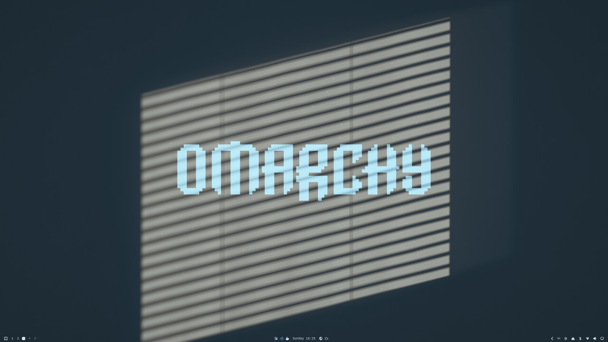
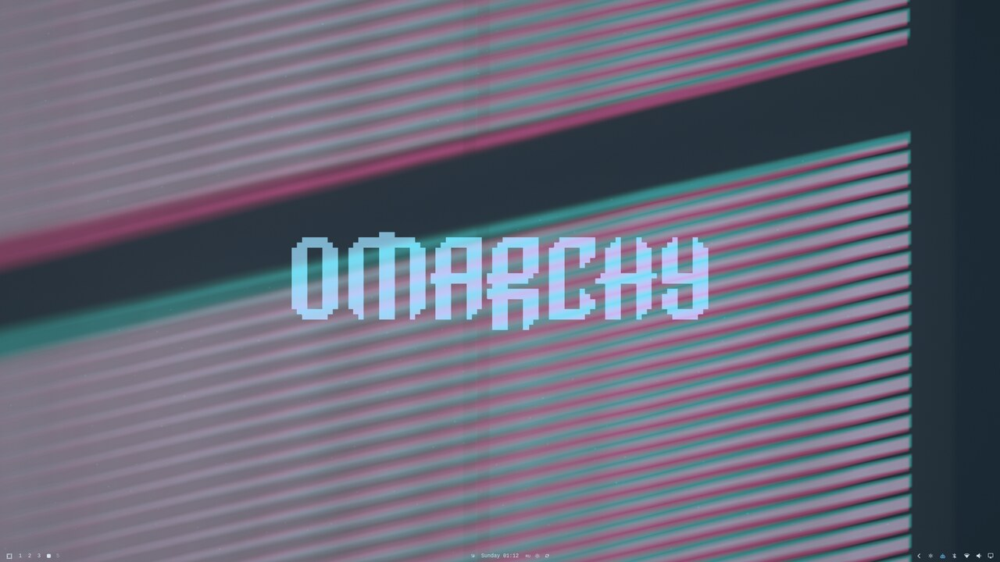
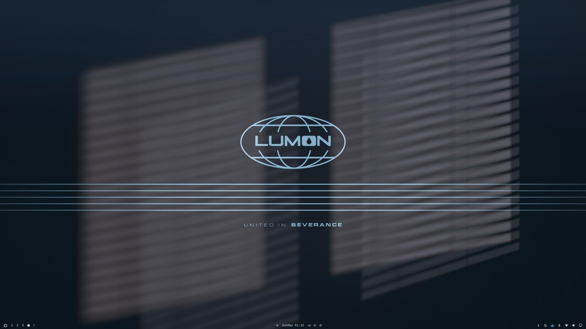
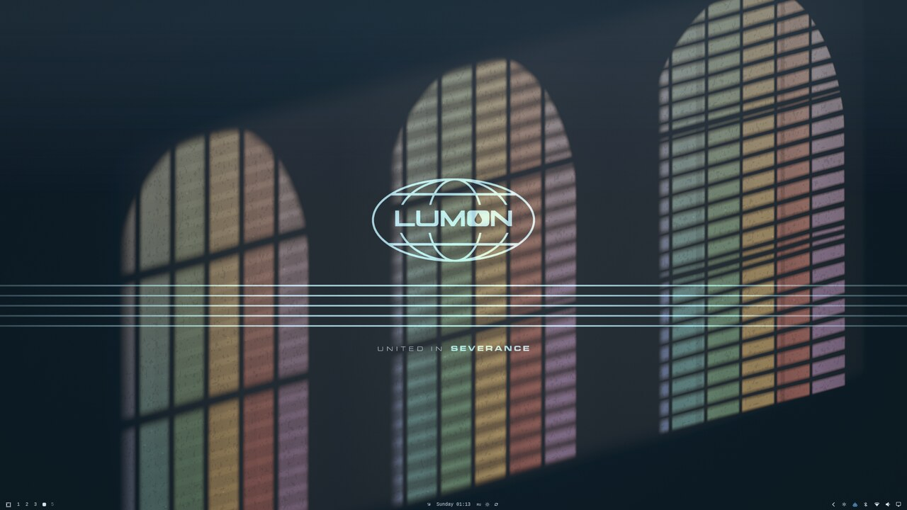
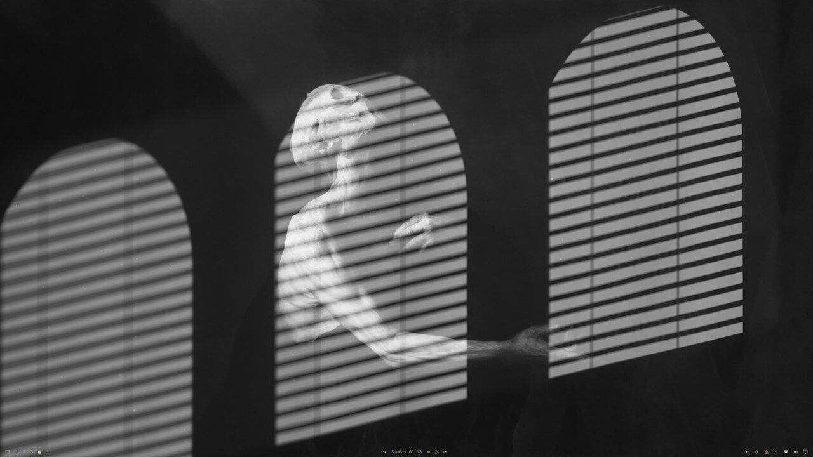
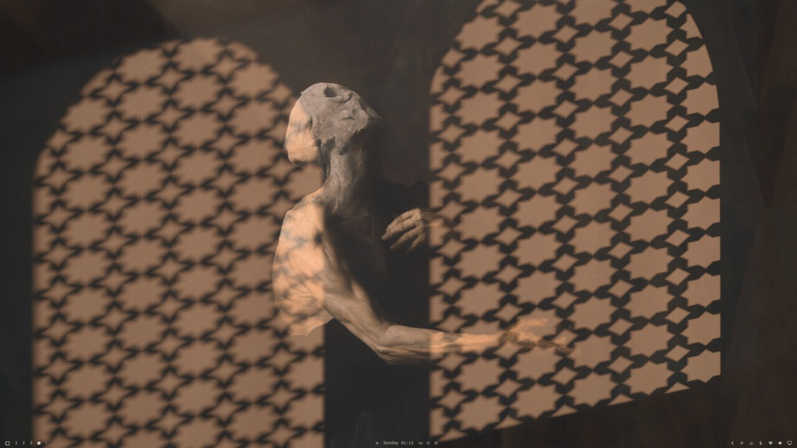

# Shades

A live wallpaper for [Omarchy](https://omarchy.org): light falls through the
blinds of a window onto your Omarchy background and moves with the real sun.
The patch slides across the wall over the day, warms toward sunset, softens
under cloud, and at night the moon takes over with its real position and
phase.

- **The real sky.** The sun and the moon as they stand over your place right
  now, dimmed and softened by the weather from Open-Meteo.
- **Six themes of the light**, from plain plaster to stained glass and a
  carved screen of stars; one gives way to another behind shut blinds.
- **Windows as you like them**: one to four in a row, from small panes to
  glass from floor to ceiling.
- **A room on the move**: a lift, a train, a ship, or a racing car through
  its corners and its tunnel.
- **Your own light**: its strength, softness and colour, from the panel.
- **Your own background.** The light falls on whatever Omarchy shows; the
  panel steps through its themes and backgrounds too.

Everything is drawn by one fragment shader: there are no videos or images
behind it, and a still wall costs nothing.

| | |
|---|---|
|  Plaster |  Neon, glass from floor to ceiling |
|  White Nights |  Vitrage, three windows |
|  Noir, arched windows |  Lattice |

Inspired by [Sunstill](https://sunstill.app) for macOS. No code or assets are
shared with it.

## Install

```bash
omarchy plugin add https://github.com/iverbovoy/shades.git --enable
omarchy restart shell
```

The plugin is a background service plus a bar widget. A click on the widget
opens the panel; a middle click turns the wall on and off.

### Your place

The sun and the moon are worked out for the place set for Omarchy's weather.
If none is set there, the plugin guesses from the time zone, which gets the
hour of the day right and little else, and it does not ask for the weather
of a place it has guessed. To set your own:

```bash
omarchy-shell shades set latitude 48.86
omarchy-shell shades set longitude 2.35
```

### Requirements

- Omarchy 4 with its Quickshell shell (`omarchy-shell`) on Hyprland. The
  plugin is used on Omarchy 4.5 and was written on 4.0.
- `curl`, for the weather. Without it the sky is always clear.
- `inotify-tools`, to follow a change of theme or background at once.
  Without it a change is noticed within a minute.
- `hyprsunset`, only for `nightlight`.

Nothing is built on install. `qt6-shadertools` is needed only to change the
shader.

## The panel

| Control | What it does |
|---------|--------------|
| Light | strength of the sun's and the moon's light, 5 to 100; a right click goes back to 25, as the theme has it |
| Soft | how soft the edges of the shadows are, 20% to 300%; a right click goes back to 100% |
| Size | how large the windows are, 40% to 300%: at the top of it the glass runs from floor to ceiling and the whole wall is lit |
| Colour | colour of the light: the theme's own, the accent of the Omarchy theme, or one of six others |
| Omarchy theme | the Omarchy theme: a click on the row opens the list of them, the arrows step back and forth |
| Background | the background of the Omarchy theme in use, picked from a list or stepped through the same way |
| Shades theme | the theme of the light, see below; the same again |
| Windows | how many windows stand in a row, one to four |
| Motion | the room on the move, see below |
| Bar | the shell's bar over the wall: solid, clear or tinted |

Under the title the panel says when the sun rises and sets and what the
weather is. A line below that, in the accent colour, names whatever is
changing the light without a control of its own: a time being previewed,
clouds forced on or the weather switched off, the shadows of the desktop's
windows, blinds that follow the volume. A wall that looks dim for no reason
usually has its reason there.

Everything the panel does not show is set in the settings file or from the
terminal, both below.

## Omarchy's theme and backgrounds

The light falls on the background Omarchy shows: the picture of the theme in
use. Stepping through themes and backgrounds in the panel runs
`omarchy theme set` and `omarchy theme bg set`, so the terminal, the editor
and everything else follow as if you had picked in the Omarchy menu; a theme
is applied once you stop clicking. Changes made elsewhere are picked up at
once, and a new background opens over the old one from the middle outward,
as Omarchy's own does.

Omarchy 4.5 plays an intro when a theme that has one is picked, and can show
a video as the background. Both are drawn by Omarchy's video player, and the
wall steps aside for them. It is gone while an intro plays and comes back
with the still picture, its blinds shut at first and then opening on the
light; it stays away for as long as the background is a video.

The background keeps its own colours. Out of the light it stands a little
lower, by day hardly at all and more at night, and the light lifts it from
there. The light reads the picture as a whole: on a dark one more of it lies
on top so that the patch still shows, on a pale one the shade is set lower to
leave the light room.

Every Omarchy theme keeps a scene of its own: the theme of the light, its
strength, softness and colour, the windows, the motion and the bar are put by
when you leave a theme and brought back when you return.

## Themes

| Theme | What it is |
|-------|------------|
| `plaster` | warm light, the default |
| `whitenights` | a northern summer: the night never quite falls. After sunset the patch does not go out but pales and softens, and goes back along the wall to where the morning will find it |
| `noir` | black and white, like film |
| `neon` | the light split into cyan and magenta: pale where both land, each one's shadows the colour of the other |
| `vitrage` | an arched window of stained glass: tall lights of cobalt, teal, green, amber, ruby and violet that colour every stripe of the blinds in turn |
| `lattice` | an arched opening with a carved screen in place of the blinds: eight-pointed stars of light, which the afternoon rounds into coins |

Every theme follows the same sky: the patch is the sun's by day and the
moon's by night, and goes where they go. One theme gives way to another
behind shut blinds: they close, the wall changes in the dark, and they open
on the new light. An Omarchy theme picked in the panel comes the same way:
the blinds stay down while the system changes and go up on the new
background.

Your own theme is a file `~/.config/shades/themes/<id>.json` with the keys
documented at the top of [`Themes.js`](Themes.js); anything left out comes
from `plaster`. Theme files are read when the shell starts:
`omarchy restart shell` after adding one.

## A room on the move

The room need not stand still (`motion`). The sun stays where it is; what
moves is the room under it.

| `motion` | What happens |
|----------|--------------|
| `lift` | it rides without end: at every floor a slab crosses the patch. A click on the bare wall stops it at the next floor; another sends it on, the other way |
| `train` | masts flick across the patch, trees and houses take the sun for a while, and every so often a tunnel shuts the day out |
| `ship` | the patch rises, sinks and leans with the swell |
| `racer` | a racing car, lap after lap. Every corner turns the car under the sun, so the light comes in at another angle and stays there down the next straight; the corners are long and the patch crosses the wall with them, leaning a little the way the car is pressed. It lifts for the corners and gathers speed out of them. The posts of the catch fence streak across the patch, the gaps between the stands come as flashes, two bridges take the sun for an instant, and in the tunnel its lamps cross the wall one after another until the car comes out into a day too bright for a moment |

While the room travels the wall is drawn at 30 frames a second or more, 60
in the racing car.

## Settings

Everything the panel sets is kept in `~/.config/shades/config.json`, which is
created on first change and reloaded when edited.

| Key | Meaning |
|-----|---------|
| `enabled` | show the wall or leave the stock background |
| `latitude`, `longitude` | where the sun is worked out for; empty = the Omarchy weather location, and where none is set, a guess from the time zone |
| `brightness` | strength of the sun's and the moon's light; 1 is as the theme has it (25 on the panel's scale) |
| `softness` | how soft the edges of the shadows are; 1 is as the sky makes them, less is sharper |
| `windowSize` | how large the windows are; 1 is the room as it was built, 3 is glass from floor to ceiling |
| `tint` | colour of the light: `"#rrggbb"`, or `accent` for the accent of the Omarchy theme; empty = the theme's own |
| `theme` | one of the themes above, or your own |
| `windowCount` | how many windows stand in a row, 1 to 4 |
| `motion` | one of the motions above; empty = a room that stands still |
| `bar` | the shell's bar over the wall: `clear` (the wall shows through) or `tint` (through a strip of the bar's own colour); empty = the shell's own solid bar. Picking one sets the bar's background to none (`omarchy bar background`), dropping it gives the bar back the background it had |

The file holds more than the panel shows. These are left as they are unless
you go looking for them, and each is explained beside its default at
`JsonAdapter` in [`Service.qml`](Service.qml): the sky (`overcast`, `rain`,
`passingClouds`, `moon`, `moonlight`, `eclipses`), the window (`window`,
`blindsFollow`, `glass`), what else can be there (`tree`, `text`, `lines`,
`textLight`, `font`, `headlights`, `dust`, `trail`, `windowShadows`,
`windowHeight`, `grain`), the desk (`layout`, `reference`, `fps`,
`pauseWhenCovered`, `saveBattery`, `nightlight`, `quiet`) and the scenes kept
for each Omarchy theme (`perTheme`, `sceneOf`, `scenes`).

## From the terminal

```bash
omarchy-shell shades toggle            # the wall on and off
omarchy-shell shades status            # what the wall is doing and why
omarchy-shell shades theme noir        # pick a theme; "" lists them
omarchy-shell shades light 1           # next theme of the light; -1 the previous
omarchy-shell shades system 1          # next Omarchy theme; -1 the previous
omarchy-shell shades background 1      # next background of the Omarchy theme; -1 the previous
omarchy-shell shades set brightness 2  # any setting from the file
omarchy-shell shades get theme         # what a setting is now
omarchy-shell shades hold              # stop the lift at the next floor, or send it on
omarchy-shell shades time 8.5          # preview 08:30
omarchy-shell shades follow            # back to the real time
omarchy-shell shades snapshot /tmp/wall.png
```

`set` refuses a value a setting cannot take and says which it can.

These make menu entries and key bindings. In
`~/.config/omarchy/extensions/omarchy-menu.jsonc`:

```jsonc
"style.shades": {"icon":"󰖨","label":"Shades"},
"style.shades.toggle": {"icon":"󰖨","label":"Wall light","action":"omarchy-shell -q shades toggle","checked":"[[ $(omarchy-shell shades get enabled) == true ]]"},
"style.shades.background": {"icon":"","label":"Next background","action":"omarchy-shell -q shades background 1"},
```

and in `~/.config/hypr/bindings.lua`:

```lua
o.bind("SUPER + CTRL + ALT + SPACE", "Next background", "omarchy-shell -q shades background 1")
```

## Network and privacy

For the weather the plugin asks [Open-Meteo](https://open-meteo.com) for the
current conditions at the configured coordinates, rounded to a hundredth of a
degree, every 15 minutes. That is its only network request, and it is not
made for a place that was only guessed.

To hear of a new theme or background it watches a folder of Omarchy's state
with `inotifywait`.

## Cost

A still wall costs nothing: it is redrawn only when the light changes. Moving
things (a room on the move, rain on the glass) redraw it many times a
second, and each of those frames makes the compositor redraw whatever lies
over the wall. So by default the wall holds still while windows cover it and
at night when nothing is lit.

## Development

```bash
scripts/dev-install.sh           # compile the shader, copy to the plugin folder, restart the shell
node tests/astronomy.test.js     # sun and moon maths against known dates
node tests/modules.test.js       # the themes and the weather
scripts/sheet.sh sheet.jpg       # every theme at four times of day on one sheet
```

The tests run on every push.

`shaders/wall.frag.qsb` is committed so that installing needs no build step;
`scripts/build-shader.sh` regenerates it (needs `qt6-shadertools`). The shell
does not pick up a changed service or shader on hot reload, hence the restart.

Layout: `Service.qml` owns the settings, the lights and the wall windows;
`Panel.qml` is the bar widget; `Sun.js` and `Moon.js` are the astronomy;
`Weather.js` the weather; `Themes.js` the built-in themes;
`shaders/wall.frag` the scene.

## Licence

[MIT](LICENSE)
